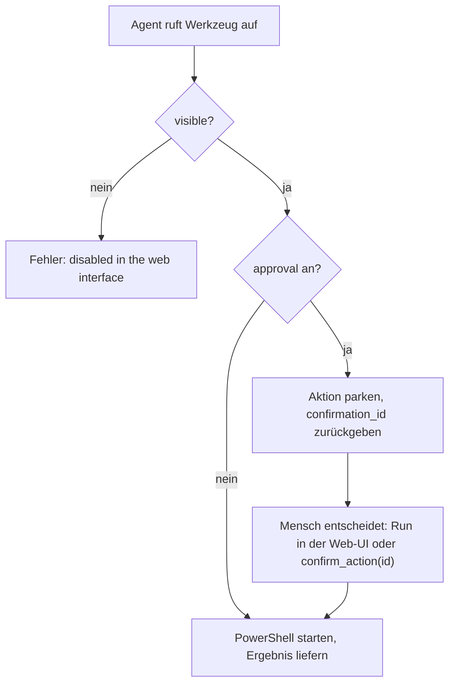

# winadmin-mcp

[](https://github.com/prinzalx/winadmin-mcp/actions/workflows/ci.yml)
[](https://nodejs.org)
[](LICENSE)

Ein Windows-Admin-MCP-Server für Agenten (Claude Code, Codex, Hermes, …): **Dienste, Event-Logs,
Prozesse, Netzwerk und Diagnose** über 20 scharf typisierte Werkzeuge — ohne dass der Agent selbst
PowerShell-Zitate bauen muss.

Dazu ein **Webinterface** (`http://127.0.0.1:8787`), in dem sich **jedes Werkzeug einzeln ein- und
ausschalten** lässt. Was aus ist, verschwindet zur Laufzeit aus `tools/list` — der Agent sieht die
Funktion schlicht nicht mehr und kann sie auch nicht aufrufen.

**Inhalt** · [Schnellstart](#schnellstart) · [Warum so eng gebaut](#warum-so-eng-gebaut) ·
[Werkzeuge](#werkzeuge) · [Approval-Gate](#approval-gate-und-umschalter) ·
[Web-UI](#die-web-ui) · [Hermes](#hermes-agent) · [Konfiguration](#konfiguration) ·
[Entwicklung](#entwicklung)

## Schnellstart

```bash
npm ci
npm run build
node dist/index.js
```

```
windows-admin-mcp web interface: http://127.0.0.1:8787
```

**stdio** ist der MCP-Transport; derselbe Prozess startet das HTTP-Interface. Beide Transporte
teilen sich dieselbe Werkzeugliste, dieselben Schalter und denselben Audit-Trail — die Web-UI kann
einem laufenden Agenten also live Werkzeuge wegnehmen, ohne dass der Agent neu starten muss.

Es sind zwei Rollen in einem Prozess: **stdio gehört dem Agenten**, der den Server beim Start selbst
spawnnt und darin liest und schreibt. Das HTTP-Interface richtet sich an den Menschen und ist
bewusst kein zweiter Server mit eigener Konfiguration.

Gebunden wird an `127.0.0.1`: Die UI löst administrative Aktionen aus, ein Zugriff aus dem Netz wäre
erst nach TLS plus Authentifizierung sicher.

### Wie sich das anfühlt

Ein echter Aufruf, ein echter Rechner:

```jsonc
// tools/call: get_service { "name": "Spooler" }
{
  "name": "Spooler",
  "display_name": "Druckwarteschlange",
  "status": "Running",
  "start_mode": "Auto",
  "log_on": "LocalSystem",
  "pid": 6924
}
```

Jede Antwort besteht aus zwei Teilen: einem lesbaren Kurztext für den Chat und
`structuredContent` mit den Daten. Agenten können sich auf den Text verlassen, Modelle mit
Schema-Bewusstsein auf die Struktur.

## Warum so eng gebaut

| Regel | Grund |
|---|---|
| **Ein Wrapper, ein Prozess** | Jede Aktion geht durch `src/utils/powershell.ts`, das genau einen `powershell.exe`-Prozess mit `-NoProfile -NonInteractive -ExecutionPolicy Bypass` startet, UTF-8 erzwingt und `$ErrorActionPreference = 'Stop'` setzt. Nur ein Ort, an dem Escape-Probleme entstehen können. |
| **Nur lokal** | Alle Werkzeuge arbeiten gegen den eigenen Rechner. Es gibt keinen `ComputerName`-Parameter und damit kein Remote-Überraschungspotenzial. |
| **Validierung vor Prozessstart** | Zod prüft die Eingabe, *bevor* PowerShell anfängt. Ein Tippfehler in einem Enum kostet keine 300 ms, sondern nur eine Fehlermeldung mit Pfad und Grund. |
| **Escaping zentral** | Jede Eingabe, die in einen PowerShell-Befehl interpolationiert wird, läuft über `psQuote` (einfache Anführungszeichen, innen verdoppelt) — die Werte bleiben in Einzeln-Anführungs-Literalen inert. |
| **Strukturierte Fehler** | `isError: true` plus Text; der MCP-Layer bleibt glücklich, das Modell sieht das Problem. Fehlgeschlagene Aufrufe landen mit Exit-Code, Dauer und Grund im Audit-Protokoll. |
| **Kein Streaming** | Ergebnisse sind einmalige JSON-Dokumente. Wer Prozesse in Echtzeit beobachten will, ruft `list_processes` erneut auf. |

## Werkzeuge

22 Werkzeuge insgesamt: 20 schaltbare aus fünf Modulen plus zwei permanente Governance-Werkzeuge.

| Modul | schaltbar | permanent |
|---|---|---|
| **Dienste** | `list_services`, `get_service`, `start_service`, `stop_service`, `restart_service`, `set_service_startmode` | |
| **Events** | `query_events`, `summary_events`, `explain_event_id` | |
| **Prozesse** | `list_processes`, `get_process`, `kill_process`, `check_ports` | |
| **Netzwerk** | `ping_host`, `test_port`, `resolve_dns`, `list_interfaces` | |
| **Diagnose** | `system_health`, `diagnose_service`, `get_windows_update` | |
| **Governance** | | `list_pending`, `confirm_action` |

Die beiden Governance-Werkzeuge sind immer aktiv und in der UI nicht schaltbar; sonst könnte ein
Agent eine geparkte Aktion nicht mehr bestätigen, nachdem ihm das letzte Werkzeug deaktiviert wurde.

### Referenz

**Dienste**

| Werkzeug | Eingabe | Antwort |
|---|---|---|
| `list_services` | `name?` (Teilstring), `status?` = `Running` \| `Stopped` \| `Paused`, `startmode?`, `search?` (Name oder Anzeigename) | Name, Anzeigename, Zustand, Startmodus, Anmeldekonto, PID |
| `get_service` | `name` (exakt, z. B. `WSearch`) | einzelner Dienst, wie die Beispielausgabe oben |
| `start_service` · `stop_service` · `restart_service` | `name`, `confirmation_id?` | Kurzmeldung plus Zustand; *destructive* |
| `set_service_startmode` | `name`, `startmode` = `automatic` \| `automatic_delayed` \| `manual` \| `disabled`, `confirmation_id?` | neuer Startmodus; *destructive* |

**Events**

| Werkzeug | Eingabe | Antwort |
|---|---|---|
| `query_events` | `log?` = `System` (Standard) \| `Application` \| `Security` \| `Setup`, `level?` (`critical`…`info`), `hours?` (Standard 24), `event_id?`, `source?`, `max_events?` (Standard 50, max 1000) | neueste zuerst, jeder Eintrag mit Zeit, ID, Stufe, Provider und Meldung (auf 400 Zeichen gekürzt) |
| `summary_events` | `log?`, `hours?` | Fehler- und Warnzählung pro Provider — der schnellste Weg zum Verantwortlichen |
| `explain_event_id` | `event_id`, `log?` (nur für die Formulierung) | Bedeutung, Schweregrad, typische Ursache. **Kein Prozessstart**: reines Nachschlagen in `src/data/event-ids.ts` |

**Prozesse**

| Werkzeug | Eingabe | Antwort |
|---|---|---|
| `list_processes` | `name?` (Teilstring), `top?` (Standard 20, max 200), `sort?` = `cpu` \| `memory` (Standard) \| `name` | Top-Prozesse mit Arbeitsspeicher und Kommandozeile |
| `get_process` | `name` (exakt, ohne `.exe`), `max_instances?` (max 100) | Details zu allen Instanzen des Namens |
| `kill_process` | `name` (mit oder ohne `.exe`), `confirmation_id?` | beendet **alle** Instanzen; *destructive* |
| `check_ports` | `port?`, `protocol?` = `TCP` \| `UDP` | ohne `port`: alle Ports mit Verbindungsanzahl; mit `port`: lauscht er oder nicht, plus Besitzprozess |

`kill_process` verschont die geschützten Systemprozesse; der Versuch auf `lsass`, `csrss`,
`svchost`, `winlogon`, `smss` oder `services` wird abgelehnt statt den Rechner zu destabilisieren.

**Netzwerk**

| Werkzeug | Eingabe | Antwort |
|---|---|---|
| `ping_host` | `host`, `count?` (Standard 4, max 10) | erreichbar ja/nein plus durchschnittliche Round-Trip-Zeit |
| `test_port` | `host`, `port`, `timeout_ms?` (Standard 3000, max 30000) | ob die TCP-Verbindung angenommen wurde — der schnellste Firewall-/Erreichbarkeitstest |
| `resolve_dns` | `name`, `record_type?` = `A` (Standard) \| `AAAA` \| `PTR` \| `MX` \| `TXT`, `server?` | Adressen mit Typ und TTL |
| `list_interfaces` | `only_up?` | Interfaces mit Zustand und Adressen |

**Diagnose**

| Werkzeug | Eingabe | Antwort |
|---|---|---|
| `system_health` | – | Computername, OS und Build, Uptime, letzter Start, CPU-Last, Arbeitsspeicher, Datenträger, Fehlerzahl der letzten 24 h |
| `diagnose_service` | `name` (exakt) | Zustand, Startmodus, Prozess, Abhängigkeiten und die letzten Logeinträge, die den Dienst erwähnen |
| `get_windows_update` | `count?` (Standard 5, max 20) | Update-Zustand aus der Registry plus neueste Installationsergebnisse |

## Approval-Gate und Umschalter

Pro Werkzeug gibt es in der Web-UI zwei Schalter:

| Schalter | Aus | An |
|---|---|---|
| **visible** | Werkzeug fehlt in `tools/list`; ein Aufruf trotzdem → `… is disabled in the web interface` | normal nutzbar |
| **approval** | Aufruf wird sofort ausgeführt | Aufruf wird geparkt, Quittung mit `confirmation_id` |



Geparkte Aktionen erscheinen in der Web-UI und werden dort mit **Run** oder **Drop** entschieden;
`list_pending` zeigt sie dem Agenten, `confirm_action` führt eine per ID aus. Parkierte Aktionen
verfallen nach 10 Minuten.

Die Approval-Schaltung ist bewusst **generisch**: sie gilt für jedes Werkzeug, das die UI als *write*
markiert (`start_service`, `stop_service`, `restart_service`, `set_service_startmode`,
`kill_process`), lässt sich aber für **jedes** Werkzeug einschalten — auch für Lesezugriffe, wenn
man kontrollieren will, wann der Agent überhaupt PowerShell starten darf.

## Die Web-UI

Die UI ist eine einzige Datei (`src/webui.html`, Vanilla JS, kein Build-Schritt) mit vier Bereichen:

| Bereich | Inhalt |
|---|---|
| **Tools** | pro Modul-Gruppe eine Zeile je Werkzeug: Name, Beschreibung, Lese-/Schreib-Abzeichen, und die zwei Schalter. Der Approval-Schalter ist deaktiviert, wenn das Werkzeug aus ist. |
| **System** | die letzte `system_health`-Ausgabe — Uptime, CPU, Arbeitsspeicher, Datenträger, Fehlerzahl |
| **Awaiting approval** | die geparkten Aktionen mit Werkzeug, Argumenten und den Buttons **Run** / **Drop** |
| **Recent activity** | die letzten Audit-Einträge: Zeit, Werkzeug, Erfolg, Dauer, Quelle |

### HTTP-Endpunkte

| Methode | Pfad | Zweck |
|---|---|---|
| `GET` | `/` | die UI |
| `GET` | `/api/state` | Version, Konfigurationspfad, Auditpfad, alle Werkzeuge mit ihren Schaltern, `pending`, letzte 25 Audit-Einträge, letzter Gesundheits-Snapshot |
| `PATCH` | `/api/tools` | `{"enabled": {…}, "requireApproval": {…}}` — Schalter schreiben, Datei speichern, Client benachrichtigen |
| `POST` | `/api/pending/<id>` | `{"action": "confirm"}` (Standard) oder `{"action": "cancel"}` |
| `POST` | `/api/run` | `{"tool": "…", "args": {…}}` — Werkzeug aus der UI heraus ausführen, auch gegen den MCP-Kanal hinweg |
| `ANY` | `/mcp` | MCP über Streamable HTTP, für Clients ohne stdio |

Jede Umschaltung wird persistiert und per `notifications/tools/list_changed` an den MCP-Client
gemeldet. Ein Client, der die Benachrichtigung ignoriert, sieht die Änderung spätestens zum nächsten
`tools/list`.

## Hermes-Agent

[Hermes](https://github.com/NousResearch/hermes-agent) spricht MCP von Haus aus: unsere Tools
erscheinen dort als `mcp_winadmin_*`, und Änderungen an der Werkzeugliste übernimmt Hermes live —
die Ein-/Aus-Schalter wirken also ohne Neustart des Agenten.

```yaml
# ~/.hermes/config.yaml   (Windows: C:\Users\<user>\.hermes\config.yaml)
mcp_servers:
  winadmin:
    command: "node"
    args: ["C:/BLOB/output/001/dist/index.js"]
    # optional, z. B. für ein schlankeres Kontextfenster:
    # tools:
    #   exclude: ["get_windows_update"]
```

```
> hey hermes, mein System ist vorhin abgestürzt — schau dir die Event Logs an,
  was könnte die Ursache sein?
```

Für diesen einen Satz braucht Hermes kein Sonderkommando, sondern vier Werkzeuge: `system_health`
für Uptime und Zeitpunkt des letzten Starts, `query_events` (`log: System`, `level: error`) für das
Fenster seit dem Boot, `explain_event_id` für Kernel-Power 41, EventLog 6008 oder Service Control
Manager 7000/7031/7034 — und `diagnose_service`, wenn ein Dienst der Auslöser war.

Für genau diesen Workflow liegt unter [`skills/windows-triage/SKILL.md`](skills/windows-triage/SKILL.md)
eine Beispiel-Skill bei, die Hermes den Triage-Ablauf beibringt: erst nachschauen, dann behaupten.

```powershell
copy -Recurse skills\windows-triage $env:USERPROFILE\.hermes\skills\
```

Danach steht die Skill in Hermes unter `/windows-triage` zur Verfügung und wird bei passenden
Anfragen automatisch angeboten.

## Konfiguration

| Umgebungsvariable | Vorgabe | Zweck |
|---|---|---|
| `WAMD_PORT` | `8787` | Port des Webinterfaces |
| `WAMD_CONFIG` | `%APPDATA%\windows-admin-mcp\config.json` | Speicherort der Schalter |
| `WAMD_AUDIT` | `%APPDATA%\windows-admin-mcp\audit.jsonl` | Append-only-Audit-Trail |

Die `config.json` schreibt die Web-UI; von Hand bearbeiten geht genauso:

```jsonc
{
  "enabledTools": { "list_interfaces": false },
  "requireApprovalTools": { "restart_service": true },
  "maxBulkItems": 20,
  "protectedProcesses": ["lsass", "csrss", "svchost", "winlogon", "smss", "services"]
}
```

Werkzeuge sind per Vorgabe aktiv, damit der Server out of the box funktioniert; deaktiviert ist erst,
was die Datei explizit ausschaltet. Die Pfade sind bewusst absolut — ein relativer Pfad würde gegen
das Arbeitsverzeichnis des MCP-Clients aufgelöst, und das ist je Client verschieden.

### Audit-Trail

Jeder Aufruf — Erfolg wie Misserfolg — landet als eine JSON-Zeile in `audit.jsonl`:

```json
{"ts":"2026-10-14T14:12:53.332Z","tool":"get_service","args":{"name":"Spooler"},
 "ok":true,"durationMs":619,"source":"web"}
```

`source` unterscheidet `mcp` (Agent) von `web` (Mensch). Die Datei wächst append-only; Rotation ist
bisher Aufgabe des Betriebes.

## Entwicklung

```bash
npm run build      # tsc + src/webui.html nach dist/ kopieren
npm run dev        # bauen und mit node --watch neu starten
npm run typecheck  # tsc --noEmit
npm test           # Smoke-Test: echter Server, echte PowerShell
```

`npm test` führt [`scripts/mcp-smoke.mjs`](scripts/mcp-smoke.mjs): Das Skript spawnt den Server auf
einem freien Port, macht einen echten MCP-Handshake und prüft 16 Punkte — Werkzeugliste,
Schema-Form, Validierung, einen echten `ping_host`-Aufruf, Approval-Parkierung, `list_pending`,
`confirm_action`, unbekannte Bestätigungs-ID sowie Enable/Disable inklusive
`list_changed`. Gegen echte PowerShell/CIM-Ausgabe, nicht gegen ein Mock: ein Cmdlet-Parameter, der
in PowerShell 5.1 nicht existiert, fällt hier auf und nicht beim Agenten.

### Projektstruktur

```
src/
  index.ts                 stdio- und HTTP-Server, MCP-Handler, Bootstrap
  config.ts                Schalter laden/speichern, Änderungen abonnieren
  safety.ts                Approval-Registry: parken, peek/take, Verfall nach 10 min
  audit.ts                 Append-only-JSONL-Trail aller Aufrufe
  types.ts                 ToolDefinition, ToolContext
  data/event-ids.ts        Wissensbasis für explain_event_id
  modules/
    services/              Liste, Zustand, Start/Stopp/Neustart, Startmodus
    events/                Query, Zusammenfassung, Event-ID-Erklärung
    processes/             Prozessliste, Details, Kill, lauschende Ports
    network/               Ping, Port-Test, DNS, Interfaces
    diagnostics/           system_health, diagnose_service, get_windows_update
  utils/
    powershell.ts          Der einzige Ort, der einen Prozess startet
    result.ts              ok/text/fail/pending — einheitliche Ergebnisse
    gate.ts                Approval-Gate für alle destruktiven Werkzeuge
  webui.html               Die komplette Web-UI (kein Build-Schritt nötig)
scripts/
  copy-webui.mjs           src/webui.html → dist/webui.html
  mcp-smoke.mjs            End-to-End über den echten MCP-Transport
  web-check.mjs            HTML, /api/state und die Schalter prüfen
skills/windows-triage/     Beispiel-Skill für Hermes
```

Ein neues Werkzeug anzulegen ist absichtlich billig: eine `ToolDefinition` in einem Modul-Ordner
(oder ein neuer Ordner in `src/modules/`), fertig — die UI, die Werkzeugliste und die
`/api/state`-Auswertung ziehen sich alles aus derselben Liste.

## Bekannte Grenzen

- **Nur Windows.** Benutzt `powershell.exe` (5.1), CIM-Namespaces und die
  `Get-NetTCPConnection`- bzw. `Get-WinEvent`-Cmdlets. PowerShell 7 wird nicht erkannt und wird
  nicht gebraucht.
- **Lokalisierte Meldungen.** Zustandstexte und Event-Meldungen kommen so aus Windows, wie das
  System eingestellt ist (auf einem deutschen Windows also deutsch). `explain_event_id` antwortet
  dagegen immer Englisch, weil die Wissensbasis im Repo liegt.
- **Zeitfenster.** `query_events` und `summary_events` nehmen `hours` an (Standard 24). Wer einen
  Crash seit dem letzten Boot sucht, setzt `hours` passend klein — seit dem Boot rechnet man am
  besten über die Uptime aus `system_health`.
- **Kosten pro Aufruf.** Jeder Werkzeugaufruf kostet einen PowerShell-Prozess, typisch 0,3–2 s je
  nach Systemlast. `explain_event_id` ist die Ausnahme: reiner Datenlookup, kein Prozessstart.
- **`maxBulkItems` ist vorbereitet, aber unverbaut.** Der Wert liegt in der Konfiguration und wird
  von keinem Werkzeug ausgewertet; er ist für zukünftige Massenaktionen gedacht.
- **Kein Auth.** Die UI ist nur lokal gebunden. Ohne TLS und Login gehört sie nicht hinter einen
  Reverse-Proxy für mehrere Menschen.

## Lizenz

MIT
