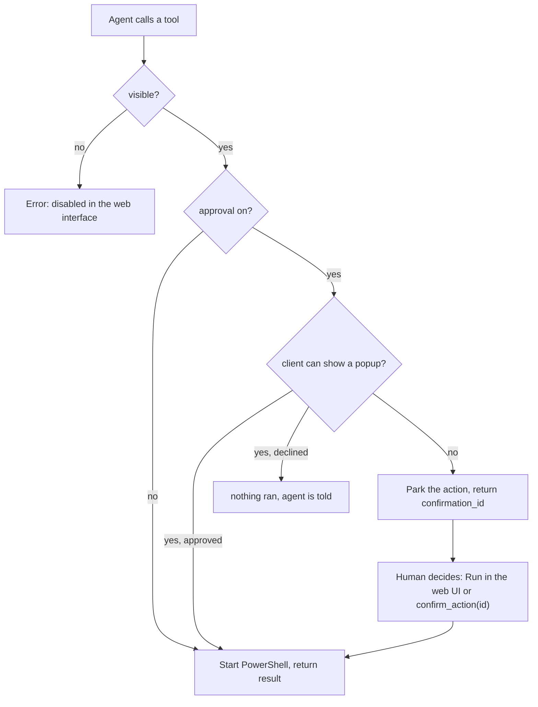

# winadmin-mcp

[](https://github.com/prinzalx/winadmin-mcp/actions/workflows/ci.yml)
[](https://nodejs.org)
[](LICENSE)

A Windows-admin MCP server for agents (Claude Code, Codex, Hermes, …): **services, event logs,
processes, network and diagnostics** through 20 sharply typed tools — without the agent having to
build PowerShell quotes itself.

Plus a **web interface** (`http://127.0.0.1:8787`), in which **every tool can be switched on and
off individually**. What is off disappears from `tools/list` at runtime — the agent simply no longer
sees the function and cannot call it either.

**Least privilege is the default:** on a fresh machine every tool starts *off*. An agent gets the
governance tools and nothing else until you decide what it may do.

**Contents** · [Quick Start](#quick-start) · [Why So Tightly Built](#why-so-tightly-built) ·
[Tools](#tools) · [Approval Gate](#approval-gate-and-switches) · [Web UI](#the-web-ui) ·
[Hermes](#hermes-agent) · [Configuration](#configuration) · [Development](#development)

## Quick Start

You need **Node.js 20 or newer** (`node --version` to check). Then three steps, all inside one
folder:

**1. Get the files.** Either clone the repository:

```bash
git clone https://github.com/prinzalx/winadmin-mcp.git
cd winadmin-mcp
```

Or, without Git: on the GitHub page click **Code → Download ZIP**, unpack the archive, and open the
resulting folder. Everything has to stay in that one folder — `src/`, `package.json`, the config and
the build output belong together.

**2. Install and build** (this creates `dist/` from the TypeScript sources):

```bash
npm ci
npm run build
```

**3. Start the server:**

```bash
node dist/index.js
```

The terminal answers with a banner and two lines about where the server lives:

```
██╗    ██╗██╗███╗   ██╗ █████╗ ██████╗ ███╗   ███╗██╗███╗   ██╗  ███╗   ███╗ ██████╗██████╗
██║    ██║██║████╗  ██║██╔══██╗██╔══██╗████╗ ████║██║████╗  ██║  ████╗ ████║██╔═════██╔══██╗
██║ █╗ ██║██║██╔██╗ ██║███████║██║  ██║██╔████╔██║██║██╔██╗ ██║  ██╔████╔██║██║     ██████╔╝
██║███╗██║██║██║╚██╗██║██╔══██║██║  ██║██║╚██╔╝██║██║██║╚██╗██║  ██║╚██╔╝██║██║     ██╔═══╝
╚███╔███╔╝██║██║ ╚████║██║  ██║██████╔╝██║ ╚═╝ ██║██║██║ ╚████║  ██║ ╚═╝ ██║╚██████╗██║
 ╚══╝╚══╝ ╚═╝╚═╝  ╚═══╝╚═╝  ╚═╝╚═════╝ ╚═╝     ╚═╝╚═╝╚═╝  ╚═══╝  ╚═╝     ╚═╝ ╚═════╝╚═╝

  web interface   http://127.0.0.1:8787
  MCP transport   stdio — this terminal stays attached to the agent
```

To be clear about what those lines are: **they are output, not arguments**. You do not pass the URL
anywhere; the server announces it, and you *surf to it in a browser*. The second line says the same
about the terminal — it is the MCP channel, so the command does not return and the window must stay
open.

In the browser, open that address and switch on what the agent is allowed to touch — the section
header carries a master switch for all tools at once, and each module group has its own pair. Until
then `tools/list` returns only `list_pending` and `confirm_action`.

**stdio** is the MCP transport; the same process starts the HTTP interface. Both transports share
the same tool list, the same switches and the same audit trail — so the web UI can take tools away
from a running agent live, without the agent having to restart.

It is two roles in one process: **stdio belongs to the agent**, which spawns the server itself at
startup and reads and writes within it. The HTTP interface is aimed at the human and is deliberately
not a second server with its own configuration.

Binding happens to `127.0.0.1`: the UI triggers administrative actions; access from the network
would only be safe after TLS plus authentication.

### What It Feels Like

A real call, a real machine:

```jsonc
// tools/call: get_service { "name": "Spooler" }
{
  "name": "Spooler",
  "display_name": "Print Queue",
  "status": "Running",
  "start_mode": "Auto",
  "log_on": "LocalSystem",
  "pid": 6924
}
```

Every response consists of two parts: a readable short text for the chat and `structuredContent`
with the data. Agents can rely on the text, models with schema awareness on the structure.

## Why So Tightly Built

| Rule | Reason |
|---|---|
| **One wrapper, one process** | Every action goes through `src/utils/powershell.ts`, which starts exactly one `powershell.exe` process with `-NoProfile -NonInteractive -ExecutionPolicy Bypass`, forces UTF-8 and sets `$ErrorActionPreference = 'Stop'`. Only one place where escape problems can arise. |
| **Local only** | All tools work against the local machine. There is no `ComputerName` parameter and therefore no remote-surprise potential. |
| **Validation before process start** | Zod checks the input *before* PowerShell starts. A typo in an enum does not cost 300 ms, only an error message with path and reason. |
| **Escaping centralized** | Every input that is interpolated into a PowerShell command goes through `psQuote` (single quotes, doubled inside) — the values stay inert inside single-quote literals. |
| **Structured errors** | `isError: true` plus text; the MCP layer stays happy, the model sees the problem. Failed calls land in the audit log with exit code, duration and reason. |
| **No streaming** | Results are one-shot JSON documents. Anyone who wants to watch processes in real time calls `list_processes` again. |

## Tools

22 tools in total: 20 switchable ones from five modules plus two permanent governance tools.

| Module | switchable | permanent |
|---|---|---|
| **Services** | `list_services`, `get_service`, `start_service`, `stop_service`, `restart_service`, `set_service_startmode` | |
| **Events** | `query_events`, `summary_events`, `explain_event_id` | |
| **Processes** | `list_processes`, `get_process`, `kill_process`, `check_ports` | |
| **Network** | `ping_host`, `test_port`, `resolve_dns`, `list_interfaces` | |
| **Diagnostics** | `system_health`, `diagnose_service`, `get_windows_update` | |
| **Governance** | | `list_pending`, `confirm_action` |

The two governance tools are always active and not switchable in the UI; otherwise an agent could no
longer confirm a parked action after its last tool had been disabled.

### Reference

**Services**

| Tool | Input | Response |
|---|---|---|
| `list_services` | `name?` (substring), `status?` = `Running` \| `Stopped` \| `Paused`, `startmode?`, `search?` (name or display name) | name, display name, state, start mode, log-on account, PID |
| `get_service` | `name` (exact, e.g. `WSearch`) | a single service, like the example output above |
| `start_service` · `stop_service` · `restart_service` | `name`, `confirmation_id?` | short message plus state; *destructive* |
| `set_service_startmode` | `name`, `startmode` = `automatic` \| `automatic_delayed` \| `manual` \| `disabled`, `confirmation_id?` | new start mode; *destructive* |

**Events**

| Tool | Input | Response |
|---|---|---|
| `query_events` | `log?` = `System` (default) \| `Application` \| `Security` \| `Setup`, `level?` (`critical`…`info`), `hours?` (default 24), `event_id?`, `source?`, `max_events?` (default 50, max 1000) | newest first, each entry with time, ID, level, provider and message (truncated to 400 characters) |
| `summary_events` | `log?`, `hours?` | error and warning counts per provider — the fastest route to the culprit |
| `explain_event_id` | `event_id`, `log?` (wording only) | meaning, severity, typical cause. **No process start**: pure lookup in `src/data/event-ids.ts` |

**Processes**

| Tool | Input | Response |
|---|---|---|
| `list_processes` | `name?` (substring), `top?` (default 20, max 200), `sort?` = `cpu` \| `memory` (default) \| `name` | top processes with memory and command line |
| `get_process` | `name` (exact, without `.exe`), `max_instances?` (max 100) | details for all instances of the name |
| `kill_process` | `name` (with or without `.exe`), `confirmation_id?` | kills **all** instances; *destructive* |
| `check_ports` | `port?`, `protocol?` = `TCP` \| `UDP` | without `port`: all ports with connection counts; with `port`: whether it is listening or not, plus owning process |

`kill_process` spares the protected system processes; an attempt on `lsass`, `csrss`, `svchost`,
`winlogon`, `smss` or `services` is rejected instead of destabilizing the machine.

**Network**

| Tool | Input | Response |
|---|---|---|
| `ping_host` | `host`, `count?` (default 4, max 10) | reachable yes/no plus average round-trip time |
| `test_port` | `host`, `port`, `timeout_ms?` (default 3000, max 30000) | whether the TCP connection was accepted — the fastest firewall/reachability test |
| `resolve_dns` | `name`, `record_type?` = `A` (default) \| `AAAA` \| `PTR` \| `MX` \| `TXT`, `server?` | addresses with type and TTL |
| `list_interfaces` | `only_up?` | interfaces with state and addresses |

**Diagnostics**

| Tool | Input | Response |
|---|---|---|
| `system_health` | – | computer name, OS and build, uptime, last boot, CPU load, memory, drives, error count of the last 24 h |
| `diagnose_service` | `name` (exact) | state, start mode, process, dependencies and the recent log entries that mention the service |
| `get_windows_update` | `count?` (default 5, max 20) | update state from the registry plus the newest installation results |

## Approval Gate and Switches

The web UI offers two switches per tool:

| Switch | Off | On |
|---|---|---|
| **visible** | tool missing from `tools/list`; a call anyway → `… is disabled in the web interface` | usable normally |
| **approval** | call executes immediately | the human is asked — in the client popup if it can show one, otherwise parked with `confirmation_id` |



Parked actions appear in the web UI and are decided there with **Run** or **Drop**; `list_pending`
shows them to the agent, `confirm_action` executes one by ID. Parked actions expire after
10 minutes.

The gate is enforced in one central place, before any tool handler runs, so it applies to **every**
tool: a read-only call such as `list_services` parks just like `stop_service` when its approval
switch is on. The read/write badge only describes what the tool does — it does not decide whether
the gate can be used. An agent that receives a `confirmation_id` gets no data yet; it has to wait
for the confirmation. An agent whose client answers the popup gets the real result in the same
call.

### Where the approval is asked (ask in agent)

A parked action alone has a flaw: the human runs it in the web interface, but the **result** lands
there and never reaches the agent — so the agent calls the tool again, and parks again, forever.

Therefore a gated tool call asks for approval **inside the MCP client** first, through the standard
MCP elicitation request (`elicitation/create`). A client with a TUI (Hermes, Claude Desktop, …)
shows a popup right where the chat is — the same mechanism as an "option A / B / C" question. If
the human approves there:

- the tool executes immediately,
- the result comes back **in the same tool call**,
- nothing parks in the web interface.

Decline or dismissal means: nothing ran, nothing parks, and the agent is told exactly that. The
switch **ask in agent** in the *Awaiting approval* header turns this off; a client that never
declared the elicitation capability is never asked and falls back to parking automatically.

The terminal says which case it is, right after the handshake:

```
  client connected: hermes 1.4.0 — popup supported
```

If it reads `not supported by this client`, the client never asked for popups and the web interface
decides instead. Over HTTP a session is kept alive between requests for the same reason: the
`tools/call` needs both the capabilities from `initialize` and an open stream to ask on.

### Who is allowed to confirm

When an action parks (popup off, or a client without elicitation), an agent that calls
`confirm_action` right after grants itself permission, which makes the gate a round trip with no
decision in it. So **by default a parked action can only be run by a human** — through the web
interface — and an agent that tries is refused and told to wait:

```
restart_service: approval is for the human in the web interface. The parked action stays pending.
```

The switch **agent may confirm** in the *Awaiting approval* header turns that off, for an agent that
is allowed to decide. While a refusal is in effect, the parked action stays parked — one failed
attempt does not consume the `confirmation_id`.

## The Web UI

The UI is a single file (`src/webui.html`, vanilla JS, no build step) with four areas:

| Area | Contents |
|---|---|
| **Tools** | per module group one row per tool: name, description, read/write badge, and the two switches. The approval switch is disabled when the tool is off. |
| **System** | the last `system_health` output — uptime, CPU, memory, drives, error count |
| **Awaiting approval** | the parked actions with tool, arguments and the **Run** / **Drop** buttons, plus the **ask in agent** and **agent may confirm** switches |
| **Recent activity** | the most recent audit entries: time, tool, success, duration, source, with a **Clear** button in the heading |

Below the two columns a footer shows the running version, and — when GitHub has a newer release — an
**update available 0.x.y** link to the [releases page](https://github.com/prinzalx/winadmin-mcp/releases).
The lookup happens once at startup and never blocks it; `WAMD_NO_UPDATE_CHECK=1` skips it entirely.

The page polls `/api/state` every two seconds and re-renders only when something actually changed,
so a tool call from the agent or a freshly parked action shows up without a manual reload. The
audit list is also read back from the audit file at startup, which means the history survives a
server restart.

**Clear** in the *Recent activity* heading empties the list. It rewrites the audit file as well, so
the entries do not come back on the next start; tool switches and pending approvals are untouched.

### HTTP Endpoints

| Method | Path | Purpose |
|---|---|---|
| `GET` | `/` | the UI |
| `GET` | `/api/state` | version, configuration path, audit path, all tools with their switches, `pending`, the last 25 audit entries, last health snapshot, latest release version |
| `PATCH` | `/api/tools` | `{"enabled": {…}, "requireApproval": {…}}` — write switches, save file, notify client |
| `PATCH` | `/api/settings` | `{"allowAgentConfirm": true\|false, "askInAgent": true\|false}` — where the approval is asked and who may run a parked action |
| `POST` | `/api/pending/<id>` | `{"action": "confirm"}` (default) or `{"action": "cancel"}` |
| `POST` | `/api/run` | `{"tool": "…", "args": {…}}` — run a tool from the UI, even across the MCP channel |
| `POST` | `/api/audit/clear` | drop the recorded calls and rewrite the audit file |
| `ANY` | `/mcp` | MCP over Streamable HTTP, for clients without stdio |

### Master switches

Above the list, the section heading carries two switches that act on **every** tool at once:
`all visible` and `all approval`. Each module group repeats the pair in its own header, for the
tools of that module only. Both are rendered as ordinary checkboxes and follow the state of their
members:

| Members | Checkbox |
|---|---|
| all on | checked |
| none on | unchecked |
| some on, some off | indeterminate (dash) |

Switching a master writes the value for all its members in one `PATCH /api/tools` request, so the
config file is saved once and the client gets one `list_changed` — not one per tool. A master
applies to all its members, including tools that are currently hidden; the per-row approval switch
being greyed out only concerns that row.

Every switch change is persisted and reported to the MCP client via
`notifications/tools/list_changed` — exactly **one** notification per change, never one per tool,
which would flood the terminal of anyone watching stdio. A client that ignores the notification
sees the change at the latest on the next `tools/list`.

### What the Terminal Shows

Because stdio belongs to the agent, the terminal is the only window into the running server. It
prints one line per call and one line per connecting client:

```
  client connected: Hermes 0.4.1
  ok   list_services (mcp) 693 ms
  ok   restart_service (mcp) 0 ms parked, waiting for approval
  err  stop_service (mcp) 858 ms
```

This is stderr, so it never interferes with the JSON-RPC frames on stdout.

## Hermes Agent

[Hermes](https://github.com/NousResearch/hermes-agent) speaks MCP out of the box: our tools appear
there as `mcp_winadmin_*`, and Hermes picks up changes to the tool list live — so the on/off
switches take effect without restarting the agent. Only *enabled* tools appear, so on a fresh
install Hermes sees the two governance tools until you switch things on.

```yaml
# ~/.hermes/config.yaml
mcp_servers:
  winadmin:
    command: "node"
    # your checkout path to the build
    args: ["<checkout>/dist/index.js"]
    # optional, e.g. for a leaner context window:
    # tools:
    #   exclude: ["get_windows_update"]
```

```
> hey hermes, my system crashed earlier — take a look at the event logs,
  what could be the cause?
```

For this one sentence Hermes needs no special command, but four tools, and those four have to be
visible first: `system_health` for uptime and the time of the last boot, `query_events`
(`log: System`, `level: error`) for the window since the boot, `explain_event_id` for Kernel-Power
41, EventLog 6008 or Service Control Manager 7000/7031/7034 — and `diagnose_service`, if a service
was the trigger. Switch on the *events* and *diagnostics* groups (or just those four rows) and the
prompt works; everything else stays out of the model's way.

For exactly this workflow, a sample skill ships at
[`skills/windows-triage/SKILL.md`](skills/windows-triage/SKILL.md); it teaches Hermes the triage
routine: look first, then claim.

```powershell
copy -Recurse skills\windows-triage $env:USERPROFILE\.hermes\skills\
```

After that the skill is available in Hermes under `/windows-triage` and is offered automatically for
matching requests.

## Configuration

```bash
node dist/index.js --help
```

| Switch | Environment variable | Default | Purpose |
|---|---|---|---|
| `--port <n>` | `WAMD_PORT` | `8787` | port of the web interface |
| `--no-web` | `WAMD_NO_WEB=1` | off | stdio only, do not bind an HTTP port |
| `--config <path>` | `WAMD_CONFIG` | `%APPDATA%\winadmin-mcp\config.json` | where the switches are stored |
| | `WAMD_AUDIT` | `%APPDATA%\winadmin-mcp\audit.jsonl` | append-only audit trail |
| | `WAMD_NO_UPDATE_CHECK` | off | skip the one-time lookup of the newest release |
| `--help` | | | print the usage text and exit |

The command line wins over the environment; both are optional. `--no-web` exists for setups where
only the MCP client should reach the machine — no HTTP port, no UI, one less listener.

The web UI writes `config.json` with one entry per tool; editing it by hand works just as well:

```jsonc
{
  "enabledTools": { "query_events": true, "system_health": true },  // the rest: false
  "requireApprovalTools": { "stop_service": true },                  // the rest: false
  "maxBulkItems": 20,
  "protectedProcesses": ["lsass", "csrss", "svchost", "winlogon", "smss", "services"],
  "allowAgentConfirm": false,
  "askInAgent": true
}
```

A config file written by an older version has no `allowAgentConfirm` entry, which means *false*: after
an upgrade an agent can no longer confirm its own parked action. A missing `askInAgent` means *true*,
so approval moves into the client popup wherever the client supports it.

Every tool starts disabled, so an entry missing from `enabledTools` means *off*. A config file that
an older version wrote with everything on keeps everything on — the default only applies to entries
that are not in the file yet. The paths are deliberately absolute; a relative path would be resolved
against the working directory of the MCP client, and that differs per client.

### Audit Trail

Every call — success as well as failure — lands as a single JSON line in `audit.jsonl`:

```json
{"ts":"2026-10-14T14:12:53.332Z","tool":"get_service","args":{"name":"Spooler"},
 "ok":true,"durationMs":619,"source":"web"}
```

`source` distinguishes `mcp` (agent) from `web` (human). In memory the trail is capped at the last
200 entries and the UI shows the last 25, so the list cannot grow without bound. Beyond that,
rotation is the operator's job — or the **Clear** button in the web UI, which drops the list and
rewrites the file.

## Development

```bash
npm run build      # tsc + copy src/webui.html to dist/
npm run dev        # build and restart with node --watch
npm run typecheck  # tsc --noEmit
npm test           # smoke test: real server, real PowerShell
```

`npm test` runs [`scripts/mcp-smoke.mjs`](scripts/mcp-smoke.mjs),
[`scripts/mcp-popup-check.mjs`](scripts/mcp-popup-check.mjs) and
[`scripts/mcp-http-popup-check.mjs`](scripts/mcp-http-popup-check.mjs): the scripts spawn the
server on a free port, perform a real MCP handshake and check 21 + 9 + 8 points — tool list, schema shape,
validation, a real `ping_host` call, approval parking (for a write tool and for a read-only one),
that an agent may **not** confirm its own parked action by default, `list_pending`,
`confirm_action`, unknown confirmation ID, and enable/disable including `list_changed`. Against real PowerShell/CIM output, not against a mock: a cmdlet parameter that does
not exist in PowerShell 5.1 shows up here and not in front of the agent.

### Project Structure

```
src/
  index.ts                 stdio and HTTP server, MCP handler, bootstrap
  config.ts                load/save switches, subscribe to changes
  safety.ts                approval registry: park, peek/take, expiry after 10 min
  audit.ts                 append-only JSONL trail of all calls
  types.ts                 ToolDefinition, ToolContext
  data/event-ids.ts        knowledge base for explain_event_id
  modules/
    services/              list, state, start/stop/restart, start mode
    events/                query, summary, event-ID explanation
    processes/             process list, details, kill, listening ports
    network/               ping, port test, DNS, interfaces
    diagnostics/           system_health, diagnose_service, get_windows_update
  utils/
    powershell.ts          the only place that starts a process
    result.ts              ok/text/fail/pending — uniform results
    gate.ts                approval gate for all destructive tools
  webui.html               the complete web UI (no build step needed)
scripts/
  copy-webui.mjs           src/webui.html -> dist/webui.html
  mcp-smoke.mjs            end-to-end over the real MCP transport
  mcp-popup-check.mjs      the approval popup, with a client that declares elicitation
  mcp-http-popup-check.mjs  the same over Streamable HTTP, in its own session
  web-check.mjs            check HTML, /api/state and the switches
skills/windows-triage/     sample skill for Hermes
```

Creating a new tool is deliberately cheap: a `ToolDefinition` in a module folder (or a new folder in
`src/modules/`), done — the UI, the tool list and the `/api/state` evaluation all draw from the same
list.

## Known Limitations

- **Windows only.** Uses `powershell.exe` (5.1), CIM namespaces and the
  `Get-NetTCPConnection` and `Get-WinEvent` cmdlets. PowerShell 7 is not detected and is not
  needed.
- **Localized messages.** State texts and event messages come out of Windows exactly as the system
  is configured (on a German Windows, in German). `explain_event_id`, by contrast, always answers in
  English, because the knowledge base lives in the repo.
- **Time window.** `query_events` and `summary_events` take `hours` (default 24). Anyone looking for
  a crash since the last boot sets `hours` small to match — for "since boot" it is best to compute
  from the uptime in `system_health`.
- **Cost per call.** Every tool call costs a PowerShell process, typically 0.3-2 s depending on
  system load. `explain_event_id` is the exception: pure data lookup, no process start.
- **`maxBulkItems` is prepared but not wired up.** The value sits in the configuration and is
  evaluated by no tool; it is intended for future bulk actions.
- **No auth.** The UI is bound to local only. Without TLS and login it does not belong behind a
  reverse proxy for multiple people.

## License

MIT
