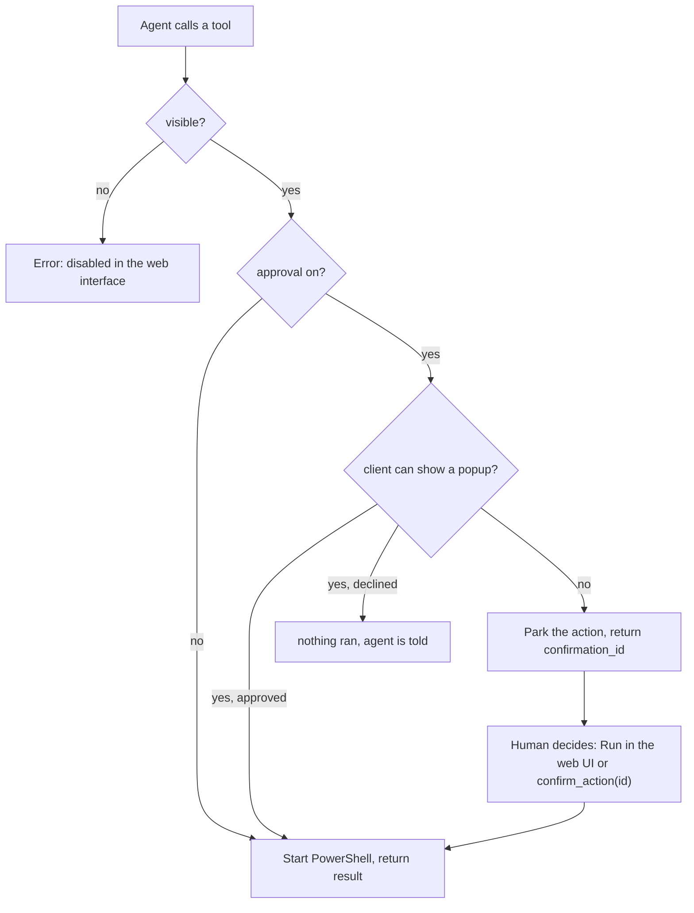

# Approval Gate and Switches

The web UI offers two switches per tool:

| Switch | Off | On |
|---|---|---|
| **visible** | tool missing from `tools/list`; a call anyway → `… is disabled in the web interface` | usable normally |
| **approval** | call executes immediately | the human is asked — in the client popup if it can show one, otherwise parked with `confirmation_id` |



Parked actions appear in the web UI and are decided there with **Run** or **Drop**; `list_pending`
shows them to the agent, `confirm_action` executes one by ID. Parked actions expire after 10 minutes.

The gate is enforced in one central place, before any tool handler runs, so it applies to **every**
tool: a read-only call such as `list_services` parks just like `stop_service` when its approval
switch is on. The read/write badge only describes what the tool does — it does not decide whether
the gate can be used. An agent that receives a `confirmation_id` gets no data yet; it has to wait
for the confirmation. An agent whose client answers the popup gets the real result in the same
call.

## Where the approval is asked (ask in agent)

A parked action alone has a flaw: the human runs it in the web interface, but the **result** lands
there and never reaches the agent — so the agent calls the tool again, and parks again, forever.

Therefore a gated tool call asks for approval **inside the MCP client** first, through the standard
MCP elicitation request (`elicitation/create`). A client with a TUI (Hermes, Claude Desktop, …)
shows a popup right where the chat is — the same mechanism as an "option A / B / C" question. If
the human approves there:

- the tool executes immediately,
- the result comes back **in the same tool call**,
- nothing parks in the web interface.

Decline or dismissal means: nothing ran, nothing parks, and the agent is told exactly that. The
switch **ask in agent** in the *Awaiting approval* header turns this off; a client that never
declared the elicitation capability is never asked and falls back to parking automatically.

Whether a client can *show* the popup depends on how it is started, not on the server. Hermes
answers the popup in its TUI (`hermes --tui`); the plain CLI does not render it, and there the
action parks for the web interface as usual.

The terminal says which case it is, right after the handshake:

```
  client connected: hermes 1.4.0 — popup supported
```

If it reads `not supported by this client`, the client never asked for popups and the web interface
decides instead. Over HTTP a session is kept alive between requests for the same reason: the
`tools/call` needs both the capabilities from `initialize` and an open stream to ask on.

## Who is allowed to confirm

When an action parks (popup off, or a client without elicitation), an agent that calls
`confirm_action` right after grants itself permission, which makes the gate a round trip with no
decision in it. So **by default a parked action can only be run by a human** — through the web
interface — and an agent that tries is refused and told to wait:

```
restart_service: approval is for the human in the web interface. The parked action stays pending.
```

The switch **agent may confirm** in the *Awaiting approval* header turns that off, for an agent that
is allowed to decide. While a refusal is in effect, the parked action stays parked — one failed
attempt does not consume the `confirmation_id`.
